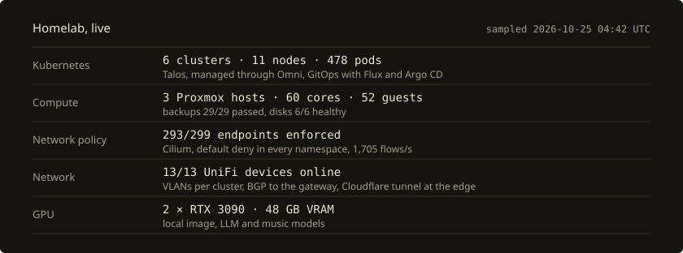
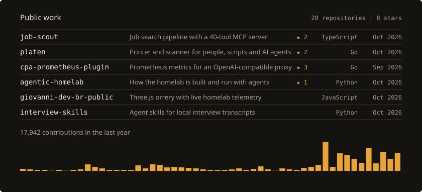

<picture>
  <source media="(prefers-color-scheme: light)" srcset="cards/header-light.svg">
  
</picture>

I design and run Kubernetes platforms. For almost seven years I was on the platform team at Exodus, a non-custodial crypto wallet and exchange. There I led the move of 30+ services from GitLab-driven delivery to Argo CD, took observability from commercial stacks to self-hosted Mimir, Loki and Tempo and then to Grafana Cloud, and wrote the Cilium network policies that later contained an SSRF callback in production. In my last year there I built MCP servers and agent skills that other teams used.

At home I run six Talos clusters on Proxmox the same way: everything through GitOps, default deny in every namespace, and alerts that reach my phone. The numbers below come from those clusters every six hours.

<picture>
  <source media="(prefers-color-scheme: light)" srcset="cards/homelab-light.svg">
  
</picture>

<picture>
  <source media="(prefers-color-scheme: light)" srcset="cards/github-light.svg">
  
</picture>

<samp>
<a href="https://giovanni.dev.br">giovanni.dev.br</a> ·
<a href="https://orrery.giovanni.dev.br">orrery</a> ·
<a href="https://resume.giovanni.dev.br">resume</a> ·
<a href="https://www.linkedin.com/in/giovanni-coutinho">linkedin</a>
</samp>
