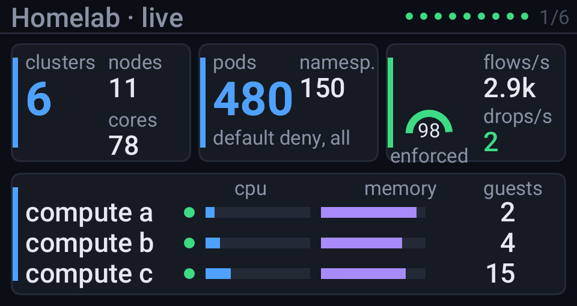
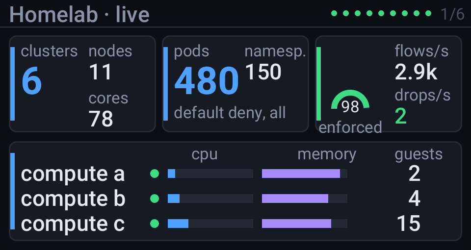
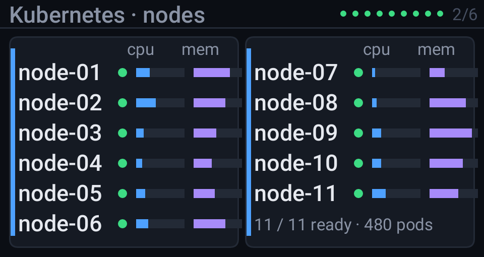
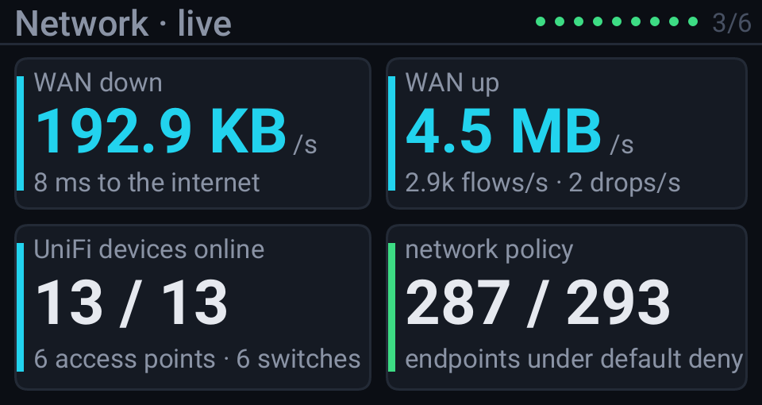
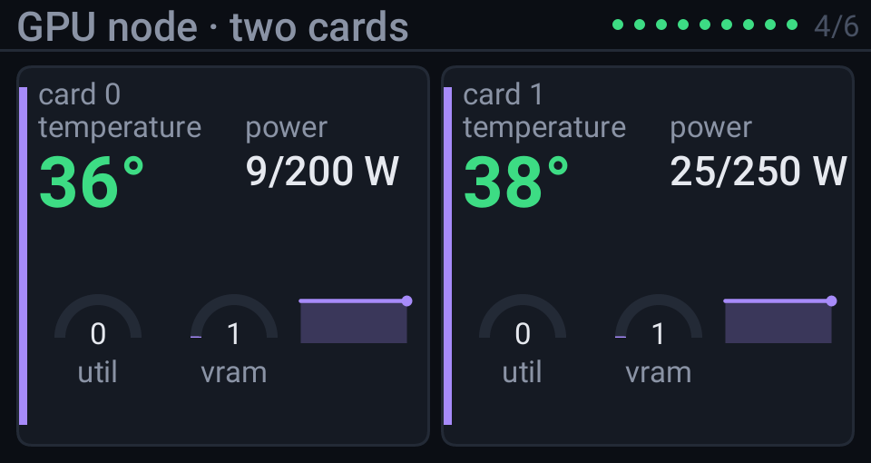
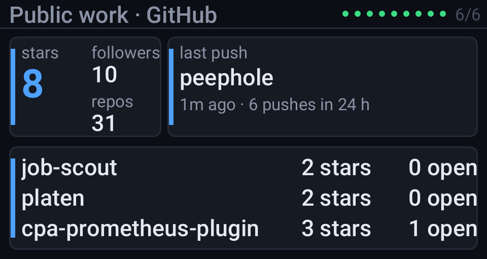

<picture>
  <source media="(prefers-color-scheme: light)" srcset="cards/header-light.svg">
  
</picture>

I design and run Kubernetes platforms. For almost seven years I was on the platform team at Exodus, a non-custodial crypto wallet and exchange. I led the move of 30+ services from GitLab to Argo CD. I took observability from commercial tools to our own Mimir, Loki and Tempo, and later to Grafana Cloud once the numbers made sense. The Cilium policies I rolled out stopped an SSRF callback during a real incident, which is still my favourite argument for default deny. In the last year I built the MCP servers and agent skills other teams ended up using.

At home I run six Talos clusters on Proxmox with the same rules: GitOps for every change and default deny in every namespace. There is a small screen on my desk that cycles through the whole lab; the frames below are the same ones it shows, drawn by [Peephole](https://github.com/giovannirco/peephole) from the lab's public telemetry every six hours. The live demo is at [peephole.bitops.com.br](https://peephole.bitops.com.br).

<samp>
<a href="https://giovanni.dev.br">giovanni.dev.br</a> ·
<a href="https://orrery.giovanni.dev.br">orrery</a> ·
<a href="https://peephole.bitops.com.br">peephole demo</a> ·
<a href="https://resume.giovanni.dev.br">resume</a> ·
<a href="https://www.linkedin.com/in/giovanni-coutinho">linkedin</a>
</samp>
